 

 

<h3>pick a quest</h3>

🤖 See what AI can actually do 
🔧 Build something small but useful 
🎮 Follow an idea just because it looks fun 
🐛 Fix one bug. Meet two more.

 

<h3>inventory</h3>

Tools I'm using and learning along the way.

 

<h3>Currently exploring</h3>

Code, AI, and anything that catches my interest. 
Building small things for the fun of it.

 

<b>open a mystery box</b>

 

<pre>
       ┌─────────────────────────┐
       │                         │
       │    +1 curiosity         │
       │    +1 unfinished idea   │
       │    +0 sleep             │
       │                         │
       └─────────────────────────┘
</pre>

You found another side project.

  

Thanks for stopping by :)

